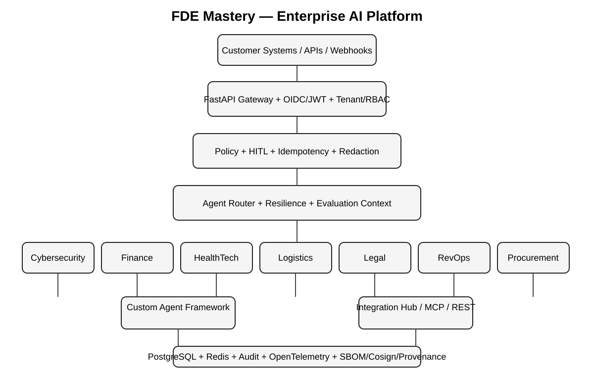

# FDE Mastery

**FDE Mastery is a governed execution platform for teams building, integrating, and operating enterprise AI agents and workflows.**

It provides reusable identity and tenancy boundaries, agent execution, durable workflows, policy enforcement, human approvals, model and tool gateways, evaluations, observability, and operational controls across eight enterprise domains.

<p align="center">
  <a href="https://github.com/LloydCoder/fde-mastery/actions/workflows/platform-tests.yml"></a>
  <a href="https://github.com/LloydCoder/fde-mastery/actions/workflows/sdk-quality.yml"></a>
  <a href="https://github.com/LloydCoder/fde-mastery/actions/workflows/evaluation.yml"></a>
  <a href="LICENSE"></a>
</p>

## Architecture at a glance



The diagram describes platform boundaries; it is not a screenshot or live deployment demonstration. See the [architecture guide](./docs/architecture/README.md).

## Why FDE Mastery

| Concern | Platform approach |
|---|---|
| Identity and tenancy | Tenant-aware identity context, scoped authorization and PostgreSQL RLS foundations |
| Agent execution | Versioned agent lifecycle, budgets, checkpoints and durable workflow boundaries |
| Consequential actions | Independent trust/policy controls, risk tiers and expiring human approvals |
| Tool and model access | Registries, capability boundaries, policy checks and provider adapters |
| Reliability | Leased work, retries, recovery, idempotency and incident lifecycle contracts |
| Evaluation | Golden and adversarial datasets, quality/safety gates and drift signals |
| Operations | OpenTelemetry-compatible observability, tenant-aware FinOps and deployment controls |
| Supply chain | CI security checks, SBOM generation, image signing and build provenance |

FDE Mastery is a modular monolith with explicit control-plane, data-plane and trust-plane boundaries. It does not split components into microservices before independent scaling or isolation is justified.

## Quick start

Run the repository tests with local in-memory and mock-provider settings. No production credentials are required.

```bash
git clone https://github.com/LloydCoder/fde-mastery.git
cd fde-mastery/packages/platform-core
python -m venv .venv
source .venv/bin/activate
python -m pip install -e ".[test]"
FDE_STORAGE_BACKEND=memory FDE_RATE_LIMIT_BACKEND=memory FDE_MONTH1_PROVIDER=mock MOCK_LLM=true FDE_ENVIRONMENT=test python -m pytest -q
```

Windows PowerShell activation uses `.venv\Scripts\Activate.ps1`. Python 3.11 matches the primary CI runtime; package metadata supports Python 3.10 and newer.

## Installation

| Tool | Requirement |
|---|---|
| Python | 3.10+; Python 3.11 is the CI baseline |
| Git | Required to clone |
| Docker Compose | Optional, for container deployment |
| Node.js | 20+ for the TypeScript SDK |

From `packages/platform-core`, install the platform and quality tools:

```bash
python -m pip install -e ".[test,quality,security,observability,sbom]"
```

Optional dependency groups are defined in [pyproject.toml](./packages/platform-core/pyproject.toml). The production-oriented Compose definition is [deployment/docker-compose.production.yml](./packages/platform-core/deployment/docker-compose.production.yml). It requires deployment-specific PostgreSQL, OIDC, application/admin key and managed-secret configuration. Follow the [deployment guide](./DEPLOYMENT.md); never use example credentials in production.

## Usage

### Inspect platform capabilities

From the repository root:

```bash
PYTHONPATH=packages/platform-core python -m platformctl manifest
PYTHONPATH=packages/platform-core python -m platformctl doctor
```

### Run the API locally

After installing the package, from `packages/platform-core`:

```bash
FDE_STORAGE_BACKEND=memory FDE_RATE_LIMIT_BACKEND=memory FDE_MONTH1_PROVIDER=mock MOCK_LLM=true FDE_ENVIRONMENT=test python -m uvicorn deployment.api_gateway.main:app --host 127.0.0.1 --port 8000
```

In another terminal:

```bash
curl --fail http://127.0.0.1:8000/v1/health
```

See [API reference](./docs/api/README.md) for authentication, tenant binding, idempotency and request metadata. Do not send customer data to a local test configuration.

### SDKs

| SDK | Runtime | Source |
|---|---|---|
| Python | Python 3.10+; standard-library HTTP client | [sdks/python](./sdks/python/) |
| TypeScript | Node.js 20+ | [sdks/typescript](./sdks/typescript/) |

## Configuration

The tracked API gateway example is [`.env.example`](./packages/platform-core/deployment/api_gateway/.env.example). It contains placeholders only. Copy values into an untracked environment file and replace every placeholder before use.

| Variable | Template example | Purpose |
|---|---|---|
| `FDE_API_KEYS` | Placeholder | Application API keys |
| `FDE_ADMIN_API_KEYS` | Placeholder | Separate administrator API keys |
| `FDE_STORAGE_BACKEND` | `memory` | Storage adapter |
| `FDE_DATABASE_URL` | Local PostgreSQL URL | Durable database connection |
| `FDE_DB_CREATE_TABLES` | `false` | Automatic table creation |
| `FDE_RATE_LIMIT_BACKEND` | `memory` | Rate-limit backend |
| `FDE_REDIS_URL` | Local Redis URL | Redis connection |
| `FDE_RATE_LIMIT_WINDOW_SECONDS` | `60` | Rate-limit window |
| `FDE_RATE_LIMIT_REQUESTS` | `60` | Request allowance |
| `FDE_MAX_BODY_BYTES` | `262144` | Maximum request body size |

See [Configuration reference](./docs/CONFIGURATION.md). Template values are not production recommendations.

## Platform domains and capabilities

| Domain | Example workflow |
|---|---|
| Cybersecurity | SIEM alert enrichment and SOC triage |
| Finance | Transaction risk and governance |
| HealthTech | Compliance and triage support |
| Logistics | Supply-chain risk analysis |
| Legal | Contract risk workflows |
| RevOps | Pipeline and account operations |
| Procurement | Supplier risk and quote comparison |
| Custom | Tenant-defined workflows and policies |

The platform provides versioned agent/tool/model/policy registries, durable workflows, tenant-scoped events, evaluation, incident management, AI FinOps, integration and interoperability boundaries, and deployment profiles.

High-impact actions remain subject to policy and human approval. Procurement is recommendation-oriented: the platform does not autonomously award suppliers, create purchase orders, modify vendor master data or approve spend.

These are reusable platform capabilities and reference integrations. They are not a security certification, regulatory approval or evidence of a live customer deployment.

## Documentation

| Guide | Description |
|---|---|
| [Documentation index](./docs/README.md) | Documentation map and reading paths |
| [Getting started](./docs/GETTING-STARTED.md) | Local setup and first checks |
| [Architecture](./docs/architecture/README.md) | Platform boundaries and dependency rules |
| [Architecture decisions](./docs/adr/) | Accepted architecture decision records |
| [API and SDKs](./docs/api/README.md) | Versioned API and client contracts |
| [Configuration](./docs/CONFIGURATION.md) | Runtime environment settings |
| [Deployment](./DEPLOYMENT.md) | Deployment model and operations |
| [Production readiness](./docs/PRODUCTION-READINESS.md) | Eight-gate promotion model |
| [Build status](./docs/BUILD-STATUS.md) | Historical implementation and verification ledger |
| [Security standards](./docs/SECURITY-STANDARDS-MAP.md) | Engineering control references |
| [AI threat model](./packages/platform-core/security/ai-threat-model.md) | AI-specific threat considerations |

## Contributing

Issues and pull requests are welcome. Read [CONTRIBUTING.md](./CONTRIBUTING.md), follow the [Code of Conduct](./CODE_OF_CONDUCT.md), and use the provided templates.

## License and acknowledgements

FDE Mastery is distributed under the [Apache License 2.0](./LICENSE). The project uses and is informed by OWASP, NIST AI RMF, OpenTelemetry, CycloneDX, Sigstore Cosign and SLSA provenance.

## Responsible use

Domain examples use synthetic or illustrative data. They are not financial, medical or legal advice. Customer deployments require their own threat model, data-protection decisions, integration validation, evaluation evidence, security review, operational runbooks and approval policy.

<details>
<summary>Support and troubleshooting</summary>

- Defects: [GitHub Issues](https://github.com/LloydCoder/fde-mastery/issues/new/choose).
- Vulnerabilities: follow [SECURITY.md](./SECURITY.md); do not publish exploit details.
- Setup: see [Getting started](./docs/GETTING-STARTED.md) and [Configuration](./docs/CONFIGURATION.md).
- Deployment: see [DEPLOYMENT.md](./DEPLOYMENT.md).

</details>
